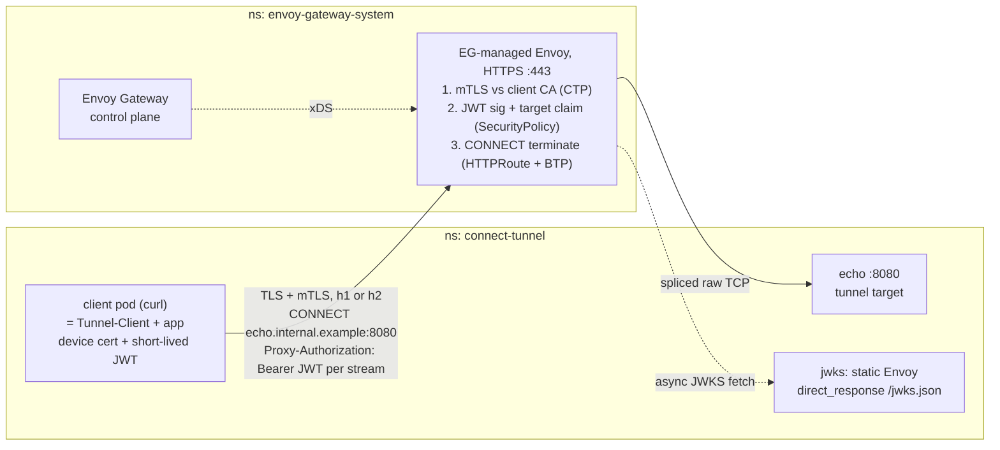

# connect-tunnel: ZTG-style CONNECT tunnels on stock Envoy Gateway

Prototype of the Zero Trust Gateway data path using only EG resources — no Go
code, no custom controller. Proves that stock EG can already do:

| Test | Result |
|------|--------|
| CONNECT without a token | 401 at the gateway (jwt filter) |
| CONNECT with a wrong `target` claim | 403 (per-route claim pinning) |
| CONNECT with a valid short-lived JWT | 200, bytes spliced to the backend |
| Same over HTTP/2 (`--proxy-http2`), stock listener | tunnel negotiated on h2, works — plain CONNECT needs no `allow_connect` |
| Phase 3: no client cert | TLS handshake rejected at the listener |
| Phase 3: client cert, no token | 401 — the two layers are independent |
| Phase 3: client cert + token (H1 and H2) | 200 — cert per device, token per stream |

The design point this validates: per-stream authentication with
controller-minted JWTs validated natively by Envoy (SecurityPolicy), instead
of a per-connection ext_authz callout — the "controller off the data path"
variant. A standalone static-config Envoy stands in for the Tunnel-Controller's
JWKS endpoint; `scripts/mint-jwt.sh` stands in for its token-minting API.

## Topology



Solid arrows are the data path; dotted arrows never sit on it — the JWKS fetch
is asynchronous and xDS is control plane, which is the point of the
native-JWT-instead-of-ext_authz variant.

## Layout

- `manifests/10-backend.yaml` — echo server, the tunnel target
- `manifests/15-client.yaml` — curl pod standing in for the Tunnel-Client
- `manifests/20-jwks-server.yaml` — standalone Envoy (static config,
  `direct_response`) serving the generated JWKS
- `manifests/30-gateway.yaml` — HTTPS listener (no hostname: clients dial by
  address, tunnel targets are matched per-route from the CONNECT authority)
- `manifests/40-route-btp.yaml` — HTTPRoute (one per target) + BTP
  `httpUpgrade: CONNECT, terminate: true`
- `manifests/50-securitypolicy.yaml` — JWT from `Proxy-Authorization`,
  authorization rule pinning the `target` claim to this route's target
- `manifests/60-patchpolicy-h2.yaml` — OPTIONAL EnvoyPatchPolicy setting
  `allow_connect: true`. Not needed for plain CONNECT (verified); it only
  enables RFC 8441 extended CONNECT (`:protocol` — WebSocket/CONNECT-UDP
  over H2). No script applies it.
- `manifests/70-ctp-mtls.yaml` — ClientTrafficPolicy requiring client certs
  from the generated client CA (phase 3, cert-per-device)

## Run

Prereqs: a cluster with EG >= v1.5.0 (CONNECT terminate; this was built against
a gateway-dev image) and `enableEnvoyPatchPolicy: true` for phase 2.

```sh
scripts/run.sh      # deploy phase 1 (H1 CONNECT + JWT)
scripts/test.sh     # 401 / 403 / 200 / echo body
scripts/test-h2.sh   # tunnel over HTTP/2 — no patch needed for plain CONNECT
scripts/test-mtls.sh # phase 3: require client certs (mTLS) + JWT together
```

`scripts/mint-jwt.sh [target] [ttl]` mints tokens; default target is
`echo.internal.example:8080`, default TTL 600s.

## Notes and known limits

- curl's `%{http_connect}` is not populated for h2 proxy tunnels; test-h2.sh
  greps the verbose "CONNECT tunnel" lines instead.
- `allow_connect` is NOT required for plain H2 CONNECT — it only advertises
  `ENABLE_CONNECT_PROTOCOL` and enables RFC 8441 extended CONNECT
  (`codec_impl.cc:1855`, `:2187`). An EG API field for it matters only when
  WebSocket or CONNECT-UDP over H2 enters the picture.
- Phase 3 requires a client cert chaining to the client CA on every
  connection; once `70-ctp-mtls.yaml` is applied, test.sh's bare curl calls
  fail at the TLS layer by design — use test-mtls.sh, or delete the
  ClientTrafficPolicy to return to phase 1/2 behavior.
- HTTP/3 is out of reach until Envoy 1.40 (QUIC mTLS, extended CONNECT
  un-gating in EG); the H2 path here is the permanent TCP fallback either way.
- Multiple app connections over one h2 connection multiplex as separate
  CONNECT streams, each carrying its own token — the target connection model.
